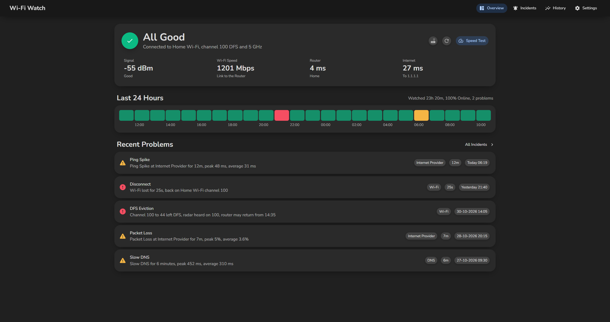
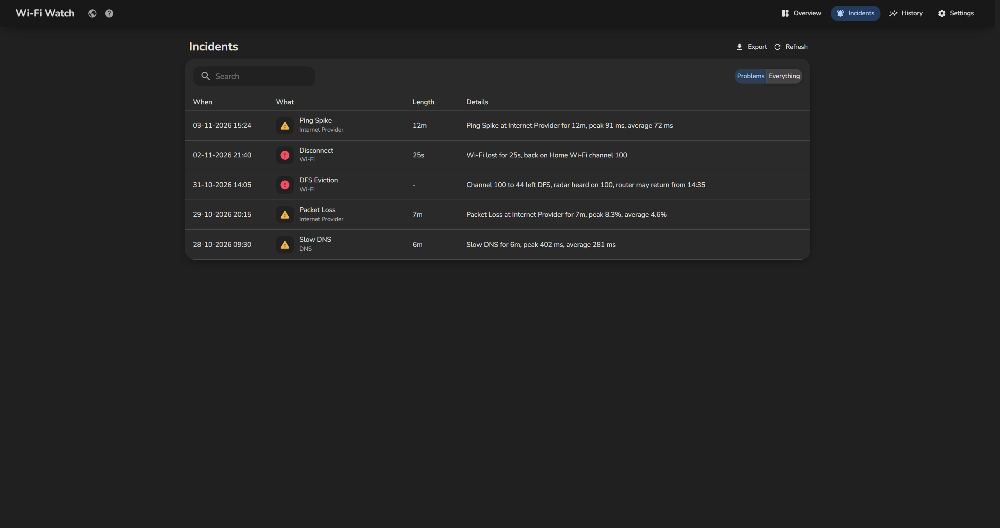
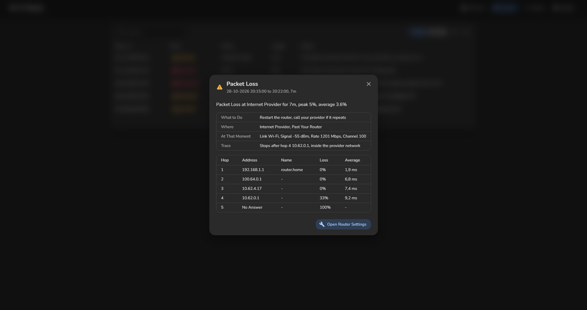
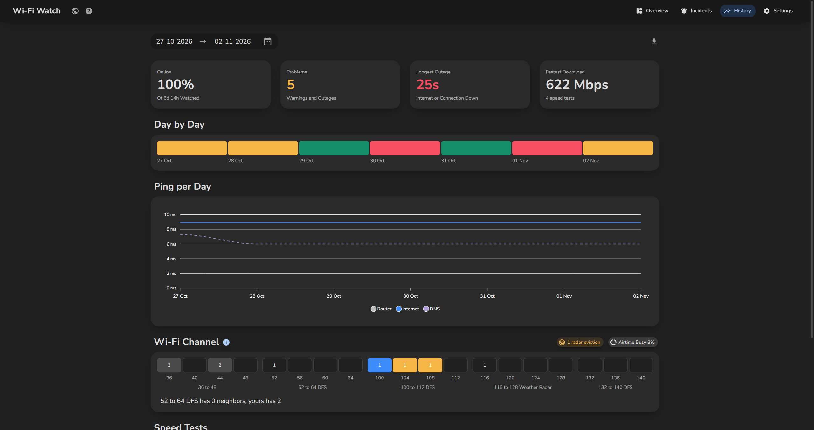
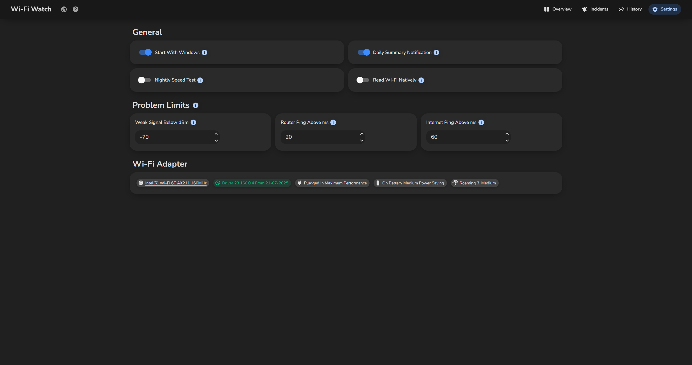

# Wi-Fi Watch

## Features
- Live status of your Wi-Fi or cable, router and internet, powerline adapters included
- Every problem logged with where it happened, why, and what to do about it
- A trace that tells your home network apart from your internet provider
- Notifications only for problems that matter
- Every hour and day at a glance, with ping charts
- Every Wi-Fi channel around you, radar evictions and which channel to pick
- Speed tests that show how much a busy line lags
- Export minutes and incidents to a spreadsheet
- English, Dutch, Turkish, German, Spanish and Russian, and it updates itself, showing what changed

## Quick start
1. Download the exe from the [latest release](https://github.com/poolfullofmilk/WiFiWatch/releases/latest)
2. Run it, there is nothing to install
3. It keeps watching from the tray, open it when something feels slow

## ⚠️ Important
- Needs Windows 11, and location services on for Wi-Fi details
- Wi-Fi details come from Windows in English, so on Windows in another language the channel, band and nearby networks can stay empty
- Windows may warn on the first run because the app is not signed: click More info, then Run anyway

## Technical details
- .NET 10, WPF, Blazor, MudBlazor and SQLite, one self-contained exe
- Everything it records stays in a local database on your PC

## Code signing policy
- Free code signing provided by [SignPath.io](https://signpath.io), certificate by [SignPath Foundation](https://signpath.org)
- Committers, reviewers and approvers: [poolfullofmilk](https://github.com/poolfullofmilk)
- Every release is built by [GitHub Actions](.github/workflows/release.yml) from this repository and approved by hand before it is signed
- Privacy: Wi-Fi Watch sends no data about you anywhere. It only pings your router and 1.1.1.1, times a DNS lookup of www.google.com, checks GitHub for a new version once a day (reading a new version's change list and checksum from GitHub's API) and talks to fast.com's servers when a speed test runs. Everything it records stays on your PC

## Screenshots

### Overview

### Incidents

### Incident

### History

### Settings

