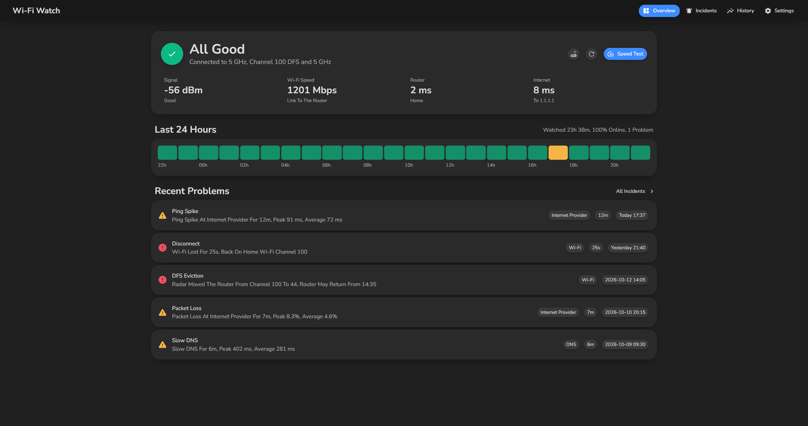
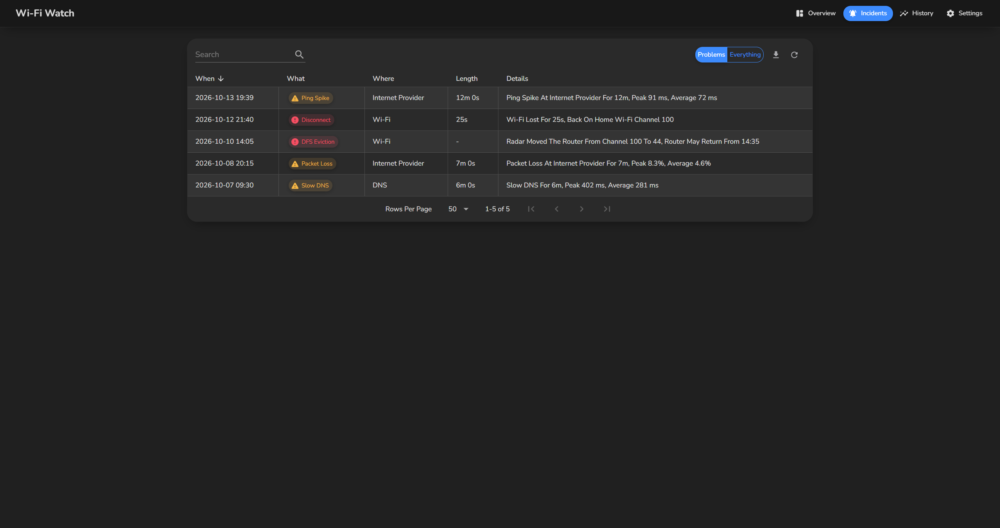
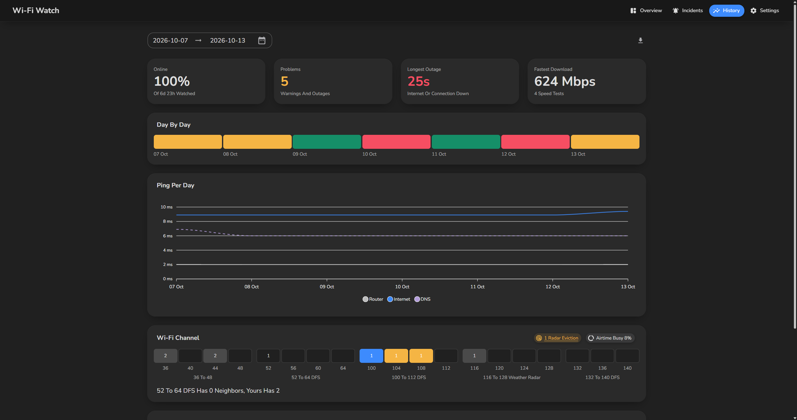
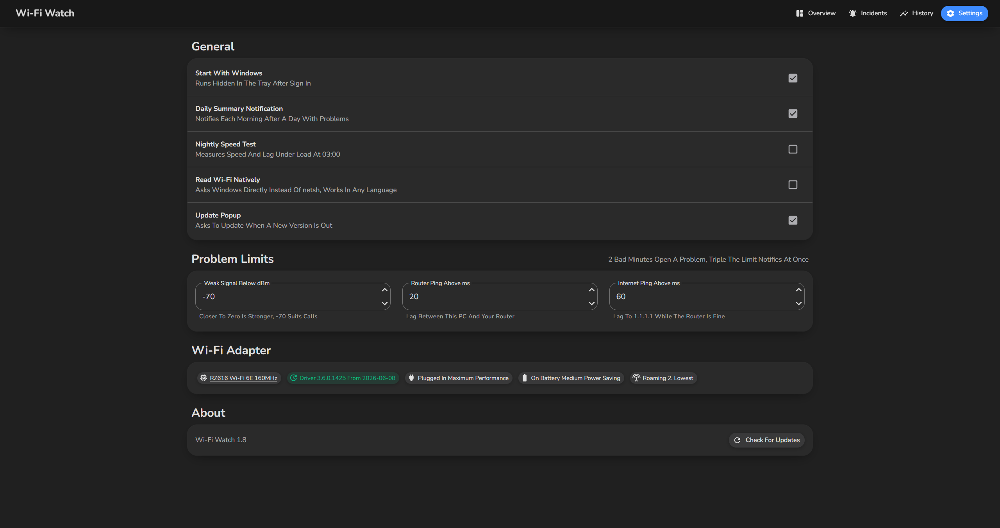

# Wi-Fi Watch

| Incidents | History | Settings |
|---|---|---|
|  |  |  |

## Features
- Live status of your Wi-Fi or cable, router and internet, powerline adapters included
- Every problem logged with where it happened and what to do
- Notifications only for problems that matter
- History, speed tests and a view of every Wi-Fi channel
- Full-app localization in English, Dutch, Turkish, German, Spanish and Russian (v1.10)

## Quick start
1. Download the exe from the [latest release](https://github.com/poolfullofmilk/WiFiWatch/releases/latest)
2. Run it, it keeps watching from the tray

## ⚠️ Important
- Needs Windows 11, and location services on for Wi-Fi details
- Windows in another language than English: turn on Read Wi-Fi Natively in Settings
- Windows may warn on the first run because the app is not signed: click More info, then Run anyway

## Technical details
- .NET 10, WPF, Blazor, MudBlazor and SQLite

## Code signing policy
- Free code signing provided by [SignPath.io](https://signpath.io), certificate by [SignPath Foundation](https://signpath.org)
- Committers, reviewers and approvers: [poolfullofmilk](https://github.com/poolfullofmilk)
- Every release is built by [GitHub Actions](.github/workflows/release.yml) from this repository and approved by hand before it is signed
- Privacy: Wi-Fi Watch sends no data about you anywhere. It only pings your router and 1.1.1.1, times a DNS lookup of www.google.com, checks GitHub for a new version once a day (reading a new version's change list and checksum from GitHub's API) and talks to fast.com's servers when a speed test runs. Everything it records stays on your PC
